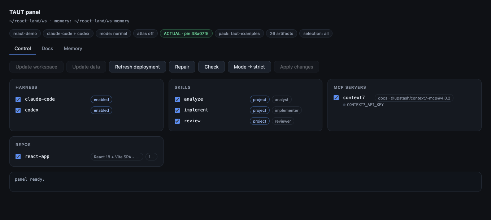
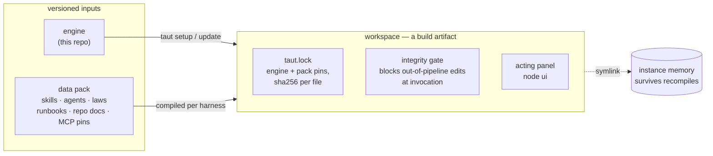

# TAUT — Toolchain Actualization Under Trust

[](https://github.com/yurgeno/taut/actions/workflows/test.yml)
[](https://github.com/yurgeno/taut/releases)
[](LICENSE)


Compile, actualize and guard **agent workspaces**: turn versioned sources (skills,
subagents, laws, runbooks, per-repo knowledge, MCP pins, model profiles) into a
ready-to-work folder for your agent harness — hash-locked, runtime-guarded, and
deliberately updatable. TAUT is harness-agnostic: sources are authored once,
harness-neutral, and compiled per harness through adapters — currently
[Claude Code](https://code.claude.com),
[Codex](https://developers.openai.com/codex) and [opencode](https://opencode.ai),
with the set designed to grow.

Zero runtime dependencies. The compiler is TypeScript executed natively by Node ≥ 24
(type stripping — no build step); compiled workspaces themselves run on any Node.
**Linux and macOS only** — the framework targets and is tested on these two platforms;
Windows is not supported.


*The acting panel (`node ui`): actualization badges, harness switches, skill / MCP /
repo checklists applied as one batched recompile, update / repair / strict-mode
controls — for every workspace, whatever pack it was compiled from.*

## Why

Hand-assembled agent setups rot in every direction at once: skills drift from their
sources, instance values leak into generic prompts, nobody can say which version of the
toolchain a session actually ran, and "just edit the file" silently defeats whatever
discipline the team agreed on. TAUT treats the workspace as a **build artifact**:

- **Compiled, never hand-edited.** `taut setup` renders everything from two versioned
  inputs — the engine (this repo) and a content **data pack** — and records both commits
  in `taut.lock` next to a sha256 for every installed file.
- **Guarded at runtime.** A self-contained gate script wires into the harness's hooks:
  a managed skill or agent that was edited outside the pipeline is **blocked at
  invocation** (fail-closed), core drift blocks prompts, and every managed invocation is
  logged to instance telemetry.
- **Actualized deliberately.** `status` tells you exactly how far the engine and the
  pack have moved past the workspace's pins; `update` re-pins on purpose; `repair`
  heals drift; nothing updates by accident.
- **Generic core, values in the pack.** The engine ships no content and hardcodes no
  instance names. Everything project-specific — repo maps, laws, ticket patterns, model
  ladders, runbooks — lives in the pack as VALUES and derives parametrically.

## How it works



Both inputs are ordinary git repositories; the lock records exactly which commit of
each a workspace runs. `status` measures the distance to their HEADs, `update` re-pins
deliberately, `repair` restores the recorded state — and the gate refuses whatever was
edited around the pipeline.

## Features

- **Multi-harness.** Harnesses are pluggable adapters over the same harness-neutral
  sources; one workspace can carry several toolchains side by side, each through its
  harness's native mechanisms — the per-harness trees are disjoint by construction
  (today: `.claude/*` + `CLAUDE.md` + `.mcp.json` for Claude Code, `.agents/skills`
  + `.codex/*` + `AGENTS.md` for Codex, `.opencode/*` + `opencode.json` for opencode —
  which reads the same Agent Skills tree and AGENTS.md natively). Enable any subset;
  switch from the panel
  without a re-setup; secrets, selections and memory survive every toggle.
- **Model profiles.** The pack declares a model ladder (per-harness model, effort,
  context variant, use-when) plus the tier the orchestrator session runs on. The
  compiler enforces it through each harness's own config surface
  (`.claude/settings.json` `model`/`effortLevel` — workspace settings beat user
  defaults; `.codex/config.toml` `model`/`model_reasoning_effort`; `opencode.json`
  `model`), renders a Model
  policy section into the instructions, and the gate advises when a live session
  deviates from the pin.
- **Strict mode.** Optionally, only the compiled toolchain runs: foreign skills,
  workspace-file-backed agents and unlisted MCP servers are denied at invocation
  (harness built-ins stay untouched).
- **Capability markers.** Sources carry conditional branches (`<!-- atlas:on -->` …)
  compiled per workspace, so a workspace never receives directives — or tool
  allowlists — for capabilities it does not have.
- **Acting panel.** `node ui` opens a loopback web panel: status badges, harness
  switches, skill/MCP/repo checklists applied as one batched recompile, update/repair
  buttons, read-only docs and instance-memory browsers. Everything explains itself on
  hover.
- **Memory outside the workspace.** Instance data (ticket memory, telemetry) lives in a
  sibling folder symlinked in; the workspace is disposable — delete and recompile, the
  memory survives.
- **Telemetry that stays home.** Usage telemetry is written ONLY to this machine
  (`memory/telemetry/`, one file per local day) and is never sent anywhere — there is no
  send mechanism by construction; `taut report` aggregates it locally. No personal data:
  no prompt content, no paths, no identities, no repository names. The level is chosen
  at setup — `extended` (default; usage + lifecycle for evaluating the framework) or
  `basic` (diagnostic minimum) — and switched any time with `taut apply --telemetry`.
- **MCP without ceremony.** Servers launch through a workspace launcher that reads
  `.taut/local.env` itself — developers fill one file, export nothing.

## Quickstart

Requires Node ≥ 24 (for the compiler only) on Linux or macOS — the only supported and
tested platforms.

The engine ships no content — skills, agents, laws and docs come from a **data pack**.
The public starter pack is
[taut-data-community](https://github.com/yurgeno/taut-data-community): a generic
three-stage development flow (analyze → implement → review, owner-gated), a
workspace-init skill that studies your repositories and generates their descriptors,
and a workspace-check readiness probe — for ANY landscape, nothing project-specific.

```bash
git clone https://github.com/yurgeno/taut.git
git clone https://github.com/yurgeno/taut-data-community.git ~/taut-data
cd taut
node taut.mjs setup
```

Setup finds the pack at `~/taut-data` automatically (resolution chain: `--data` flag →
the workspace's own binding → `TAUT_DATA` env → `<workspace-parent>/taut-data` sibling
→ `~/taut-data`). Two things to know before you answer: **member repos are scanned from
the workspace folder's PARENT** (two levels deep), and at least one must be selected —
so give a workspace path inside the folder that holds your repos; the folder is created
if it does not exist.

Setup then asks (in order): data pack, deployment, workspace folder, member repos,
harness(es), Atlas (say `disable` unless you know what it is), mode, skills, MCP servers
— and compiles. Open the compiled workspace folder with your harness and work; from that
folder:

```bash
node ui          # the acting panel
node ui status   # actualization check: pins vs HEADs, integrity, MCP pins
node ui check    # readiness self-test: integrity, live gate probe, repos, MCP handshakes
```

After the first compile, open the workspace with your harness and run the
`workspace-init` skill — it fills each repo's descriptor with verified working
knowledge. To author your own pack instead of the community one, see
[docs/TUTORIAL.md](docs/TUTORIAL.md) and [docs/PACK.md](docs/PACK.md); keep the pack as
`taut-data` next to your workspace or pass `--data <path>`.

Working on TAUT itself additionally needs the dev dependencies (a typechecker — the
compiler ships none at runtime):

```bash
npm install && npm test
```

## Documentation

| Where | What |
|---|---|
| [docs/TUTORIAL.md](docs/TUTORIAL.md) | **authoring your own pack** — builds a complete pack file by file (a three-stage flow for a React SPA, agents, model profiles, a runbook, per-repo knowledge, context7); to just RUN TAUT, install [taut-data-community](https://github.com/yurgeno/taut-data-community) instead |
| [docs/HANDBOOK.md](docs/HANDBOOK.md) | using TAUT: setup, workspace anatomy, the lock and the gate, update vs repair vs apply, the panel, strict mode, multi-harness, model profiles, memory |
| [docs/PACK.md](docs/PACK.md) | authoring data packs: every element kind, frontmatter wiring, capability markers, deployment configs, model ladders, runbooks, repo descriptors |
| [taut-data-community](https://github.com/yurgeno/taut-data-community) | the public starter DATA PACK — generic dev flow + workspace-init/-check skills; its own README and manual cover installation and adaptation |
| `node taut.mjs --help` | the full command reference |

## Repo map

| Path | Role |
|---|---|
| `taut.mjs` | CLI entry (plain-JS shell: argv, help, dispatch; Node-floor guard) |
| `lib/*.mts` | the compiler — TypeScript run natively by Node; `tsc --noEmit` is the checker |
| `gate/gate.mjs` | the SHIPPED integrity gate (self-contained plain JS — runs on any workspace Node) |
| `gate/mcp-launch.mjs` | the SHIPPED MCP launcher (reads `.taut/local.env` at server start) |
| `test/` | `node --test` suites, each in its own sandbox; `npm test` = typecheck + suite |

## Contributing

Issues and pull requests are welcome — [CONTRIBUTING.md](CONTRIBUTING.md) covers the
dev setup and the few ground rules (the big one: the engine keeps its **zero runtime
dependencies**). `npm test` — typecheck plus the full suite, each in its own sandbox —
must stay green.

## Security

TAUT ships an enforcement surface (integrity gate, strict mode, the panel's token
guard). Found a hole in it? [SECURITY.md](SECURITY.md) — report privately, please.

## License

[Apache-2.0](LICENSE) © Yuriy Orlov
